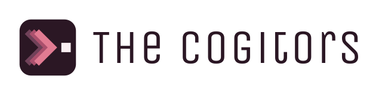

<p>
  <picture>
    <source media="(prefers-color-scheme: dark)" srcset="assets/logo-dark.svg">
    
  </picture>
</p>

> "The eyes of common perception do not see far. Too often we make the most important decisions based only on superficial information."
>
> — Cogitor Kwyna

<p>
  <a href="https://milowda.com"></a>
  <a href="LICENSE"></a>
  <a href="https://github.com/erayendes/cogitors/actions/workflows/ci.yml"></a>
  <a href="https://www.npmjs.com/package/cogitors"></a>
  
  
  <a href="https://agentskills.io"></a>
</p>

🇹🇷 [Türkçe](docs/README.tr.md)

---

When a critical architecture choice, security review or product decision is on the line, consulting a single AI is risky: a model cannot see its own hallucinations, biases and blind spots, and **it can defend flawed assumptions with complete confidence.**

## Three Models

**The Cogitors** brings three model families — **Codex (OpenAI)**, **Claude (Anthropic)** and **Antigravity (Google)** — to one deliberation table.
Every model receives the whole task. Over four rounds they analyze independently, read each other's views and answer objections with evidence. In round five the Elder synthesizes one reasoned decision.

> **Core principle:** Consensus is not proof of correctness.
> Reasoned minority views and uncertainties are never suppressed; they are preserved in the final decision.

---

## Six Skills

### `/cogitors`

The skill that gives the project its name starts a five-round deliberation protocol with three agents.

```text
- /cogitors Review this architecture proposal together. Do not change any code, and state unresolved objections explicitly.
- /cogitors --git-diff HEAD~1 Deliberate on this PR's changes for security and performance.
```

#### Five Rounds

```text
                 ┌───────────────────────┐
                 │    /cogitors <task>   │
                 └───────────┬───────────┘
Round 1: Initial Analysis    │
Each agent examines the task alone, without seeing the others.
                             ▼
──────────────────────────────────────────────────────────
   ┌─────────────┐   ┌─────────────┐   ┌─────────────┐
   │    Codex    │   │ Antigravity │   │   Claude    │
   └─────────────┘   └─────────────┘   └─────────────┘
─────────────────────────────┬────────────────────────────
                             ▼
                 ┌───────────────────────┐
                 │    Drafts Unsealed    │
                 └───────────┬───────────┘
Round 2: Reconsideration     │
Agents read each other's drafts and may update their views.
                             ▼
──────────────────────────────────────────────────────────
   ┌─────────────┐   ┌─────────────┐   ┌─────────────┐
   │    Codex    │   │ Antigravity │   │   Claude    │
   └─────────────┘   └─────────────┘   └─────────────┘
─────────────────────────────┬────────────────────────────
Round 3: Debate              │
Each agent defends its view with evidence and objects where it disagrees.
                             ▼
──────────────────────────────────────────────────────────
   ┌─────────────┐   ┌─────────────┐   ┌─────────────┐
   │    Codex    │─x─│ Antigravity │─x─│   Claude    │
   └─────────────┘   └─────────────┘   └─────────────┘
─────────────────────────────┬────────────────────────────
Round 4: Final Position      │
Objections are answered and each agent sets its final stance.
                             ▼
──────────────────────────────────────────────────────────
   ┌─────────────┐   ┌─────────────┐   ┌─────────────┐
   │    Codex    │   │ Antigravity │   │   Claude    │
   └─────────────┘   └─────────────┘   └─────────────┘
─────────────────────────────┬────────────────────────────
Round 5: Synthesis           │
The Elder gathers agreements, minority views and uncertainties into one decision.
                             ▼
                      ┌──────────────┐
                      │    Elder     │
                      └──────────────┘
```

#### Decision Outputs and Directory Layout

Every session is saved in the task's language under your project's `docs/cogitors/` directory. Working files go to the session's `temp/` folder, which git ignores and which is deleted once the report is finished:

```text
<project-root>
  docs/cogitors/<time-stamp>-<slug>/
  ├── temp/                  # working files; removed when the session finishes
  ├── antigravity-<slug>.md
  ├── brief-<slug>.md
  ├── claude-<slug>.md
  ├── codex-<slug>.md
  ├── decision-<slug>.md
  ├── decision-<slug>.json   # only with --export-json
  ├── decisions-<slug>.html
  ├── metrics-<slug>.json    # durations, calls, reported tokens, revisit date; no model text
  └── followup-<slug>.md     # answers to follow-up questions, after the first one
```

- **Evidence check:** Quotes the Elder cites in the synthesis are checked against the shared files and marked as matched or not. A match proves the quote exists, not that the claim is right.
- **Metrics:** `npx cogitors metrics` summarizes time, calls and per-agent tokens across finished sessions; tokens show as `unknown` when a provider reported none.
- **Follow-up questions:** Every part of the HTML report has an **Ask** button. Ask one question or collect several, paste them into the chat, and the Elder answers from the session record without new model calls. Answers appear under the part you asked about; the decision itself never changes.
- **Revisit:** The Elder can set a revisit date and what would show the decision was right; `npx cogitors revisit` lists the sessions whose date has come. Each reasoned dissent can also name the evidence that would settle it.

`cogitors` itself never switches models.

#### Limits, Cost and Safety

- **Cost:** A session makes 8 external model calls (plus any timeout retries you approve), and you approve the scope, including every shared file's path, size and hash, before any call starts. `--max-calls N` sets a hard ceiling, retries included.
- **Source code:** Deliberation never edits code; if a source file changes, the session stops.
- **Participation:** If an agent fails, you are asked; a session never continues with fewer than 2 participants.
- **Time:** 180 seconds per call and 1800 seconds per session (`--timeout`, `--total-timeout`).

### `/<model> <task>`

Codex, Antigravity or Claude is called onto a task and gets it done in the background.

```text
- /antigravity Find the contradicting clauses in this technical spec.
- /claude Analyze the performance bottlenecks in this PR diff.
- /codex List the weaknesses in the authentication flow without changing code.
```

### `/voltron <task>`

This skill forms Voltron: the agent you talk to is the Black Lion.

It splits the job into parts; up to four other models and accounts build one part each at the same time as the Red, Yellow, Green and Blue Lions.

The Black Lion joins the parts and runs the checks.

```text
- /voltron Build the checkout flow: API, UI and tests.
```

### `/lions <task>`

This skill sends the lions to the same task instead. Each looks at the work from its own view, and in the end the Black Lion merges what they find. It suits a code review or a second opinion.

```text
- /lions Review this repository for bugs.
```

The Black Lion picks a model for each lion and starts at once; their output is for the Black Lion, which gives you one summary.

It reads each lion's quota with `cogitors quota`. It assigns the lions' work by quota first, then by effort, the work's size and its risk.

It also reserves a management share of its own quota sized to the job. When its remaining quota is below that share or unknown, it hands joining and verification to another lion as well.

The Black Lion weighs `/voltron` and `/lions` on every task and, when they fit, proposes them with a reason and the lion's share.

When a lion or a `/codex`, `/claude` or `/antigravity` call hits a definite quota error, the work moves on its own to another capable model or account with room, and the status line says so.

Work that changes files runs in a separate git worktree per lion.

---

## Quick Install

Run `npx skills add erayendes/cogitors` and install all six skills. Details [here](docs/installation.md).

Which CLIs and accounts you use, and their default models, live only in your own `~/.cogitors/config.json`.

---

## The Story Behind the Name

**Cogitors** are ancient minds in the Dune universe that left their bodies behind and, preserved in a protective fluid, **devote thousands of years to thought**.
They reach a conclusion only after thinking and debating at length, never in haste.
This project takes its name from them: several models think through the same question without haste, questioning themselves and each other.

**Voltron** is simply **Voltron**.

---

[Report a bug](https://github.com/erayendes/cogitors/issues/new?template=bug_report.yml) · [Request a feature](https://github.com/erayendes/cogitors/issues/new?template=feature_request.yml) · [Support](.github/SUPPORT.md) · [Security](.github/SECURITY.md) · [Contributing](.github/CONTRIBUTING.md) | [MIT](LICENSE) © [Eray Endes](https://github.com/erayendes)
