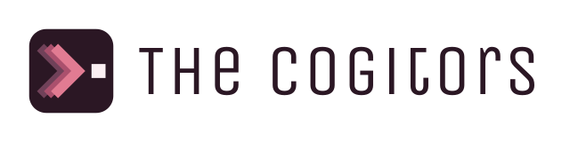

<p>
  <picture>
    <source media="(prefers-color-scheme: dark)" srcset="../assets/logo-dark.svg">
    
  </picture>
</p>

> “Sıradan algının gözleri uzağı göremez. Çoğu zaman en önemli kararlarımızı yalnızca yüzeysel bilgilere dayanarak alırız.”
>
> — Cogitor Kwyna

<p>
  <a href="https://milowda.com"></a>
  <a href="../LICENSE"></a>
  <a href="https://github.com/erayendes/cogitors/actions/workflows/ci.yml"></a>
  <a href="https://www.npmjs.com/package/cogitors"></a>
  
  
  <a href="https://agentskills.io"></a>
</p>

🇬🇧 [English](../README.md)

---

Kritik bir mimari tercih, güvenlik denetimi veya ürün kararı gerektiğinde tek bir yapay zekaya danışmak risklidir: Model kendi halüsinasyonlarının, önyargılarının ve kör noktalarının farkına varamaz; **hatalı varsayımlarını son derece özgüvenli bir üslupla savunabilir.**

## Üç Model

**The Cogitors**, üç model ailesini — **Codex (OpenAI)**, **Claude (Anthropic)** ve **Antigravity (Google)** — tek bir müzakere masasında bir araya getirir. 
Üç modele de aynı işin tamamı verilir. Dört tur boyunca bağımsız analiz yapar, birbirlerinin görüşlerini okur, itirazlara kanıtla yanıt verirler. Beşinci turda Elder tek bir gerekçeli karar sentezler.

> **En önemli ilke:** Görüş birliği (konsensüs) doğruluk kanıtı değildir.
> Makul ve gerekçeli azınlık görüşleri ile belirsizlikler bastırılmaz; nihai kararda aynen korunur.

---

## Altı Skill

### `/cogitors`

Projeye ismini veren bu skill, üç ajanlı 5 turlu bir müzakere protokolünü başlatır.

```text
- /cogitors Bu mimari öneriyi birlikte inceleyin. Kodları değiştirmeyin ve çözülemeyen itirazları açıkça belirtin.
- /cogitors --git-diff HEAD~1 Bu PR'daki değişiklikleri güvenlik ve performans açısından müzakere edin.
```

#### Beş Tur

```text
                 ┌───────────────────────┐
                 │    /cogitors <task>   │
                 └───────────┬───────────┘
Tur 1: Bağımsız Analiz       │
Her ajan görevi tek başına, diğerlerini görmeden inceler.
                             ▼
──────────────────────────────────────────────────────────
   ┌─────────────┐   ┌─────────────┐   ┌─────────────┐
   │    Codex    │   │ Antigravity │   │   Claude    │
   └─────────────┘   └─────────────┘   └─────────────┘
─────────────────────────────┬────────────────────────────
                             ▼
                 ┌───────────────────────┐
                 │  Taslakların Açılması │
                 └───────────┬───────────┘
Tur 2: Yeniden Değerlendirme │
Ajanlar birbirinin taslağını okur, isterse görüşünü günceller.
                             ▼
──────────────────────────────────────────────────────────
   ┌─────────────┐   ┌─────────────┐   ┌─────────────┐
   │    Codex    │   │ Antigravity │   │   Claude    │
   └─────────────┘   └─────────────┘   └─────────────┘
─────────────────────────────┬────────────────────────────
Tur 3: Münazara              │
Her ajan görüşünü kanıtla savunur ve katılmadığı görüşlere itiraz eder.
                             ▼
──────────────────────────────────────────────────────────
   ┌─────────────┐   ┌─────────────┐   ┌─────────────┐
   │    Codex    │─x─│ Antigravity │─x─│   Claude    │
   └─────────────┘   └─────────────┘   └─────────────┘
─────────────────────────────┬────────────────────────────
Tur 4: Nihai Pozisyon        │
İtirazlar yanıtlanır, her ajan son duruşunu belirler.
                             ▼
──────────────────────────────────────────────────────────
   ┌─────────────┐   ┌─────────────┐   ┌─────────────┐
   │    Codex    │   │ Antigravity │   │   Claude    │
   └─────────────┘   └─────────────┘   └─────────────┘
─────────────────────────────┬────────────────────────────
Tur 5: Sentez                │
Elder, uzlaşmaları, azınlık görüşlerini ve belirsizlikleri tek kararda toplar.
                             ▼
                      ┌──────────────┐
                      │    Elder     │
                      └──────────────┘
```

#### Karar Çıktıları ve Dizin Yapısı

Her oturum, görevin dilinde, projenizin `docs/cogitors/` dizinine kaydedilir. Çalışma dosyaları oturumun `temp/` klasörüne yazılır; git bu klasörü görmez ve rapor tamamlanınca klasör silinir:

```text
<project-root>
  docs/cogitors/<time-stamp>-<slug>/
  ├── temp/                  # çalışma dosyaları; oturum bitince silinir
  ├── antigravity-<slug>.md
  ├── brief-<slug>.md
  ├── claude-<slug>.md
  ├── codex-<slug>.md
  ├── decision-<slug>.md
  ├── decision-<slug>.json   # yalnızca --export-json ile
  ├── decisions-<slug>.html
  ├── metrics-<slug>.json    # süreler, çağrılar, bildirilen token'lar, yeniden bakış tarihi; model metni yok
  └── followup-<slug>.md     # takip sorularının cevapları, ilk sorudan sonra
```

- **Kanıt kontrolü:** Elder'ın sentezde aktardığı alıntılar paylaşılan dosyalarda aranır ve eşleşip eşleşmediği işaretlenir. Eşleşme alıntının var olduğunu kanıtlar, iddianın doğru olduğunu değil.
- **Metrikler:** `npx cogitors metrics` biten oturumlardaki süreyi, çağrıları ve ajan başına token'ları özetler; sağlayıcı bildirmediyse token `unknown` görünür.
- **Takip soruları:** HTML raporun her bölümünde bir **Sor** düğmesi var. Tek bir soru sorun ya da birkaçını biriktirin, sohbete yapıştırın; Elder yeni model çağrısı yapmadan oturum kaydından cevaplar. Cevaplar sorduğunuz bölümün altında görünür; kararın kendisi hiç değişmez.
- **Yeniden bakış:** Elder, karara yeniden bakılacak bir tarih ve kararın doğru çıkıp çıkmadığını neyin göstereceğini yazabilir; `npx cogitors revisit` tarihi gelen oturumları listeler. Her gerekçeli ayrışma, onu neyin netleştireceğini de belirtebilir.

`cogitors` kendisi hiçbir zaman model değiştirmez.

#### Sınırlar, Maliyet ve Güvenlik

- **Maliyet:** Bir oturum 8 harici model çağrısı yapar (onayladığınız zaman aşımı tekrarları hariç); çağrılar başlamadan önce, paylaşılan her dosyanın yolu, boyutu ve hash'i dahil kapsamı siz onaylarsınız. `--max-calls N` tekrarlar dahil kesin bir üst sınır koyar.
- **Kaynak kod:** Müzakere kodu değiştirmez; bir kaynak dosya değişirse oturum durur.
- **Katılım:** Bir ajan başarısız olursa size sorulur; 2 katılımcının altında oturum sürmez.
- **Süre:** Çağrı başına 180 saniye, oturum başına 1800 saniye (`--timeout`, `--total-timeout`).

### `/<model> <görev>`

Codex, Antigravity ya da Claude göreve çağrılır ve işini arka planda halleder.

```text
- /antigravity Bu teknik şartnamede çelişen maddeleri bul.
- /claude Bu PR diff'indeki performans darboğazlarını analiz et.
- /codex Kimlik doğrulama akışındaki açıkları kod değiştirmeden listele.
```

### `/voltron <görev>`

Bu skill Voltron'u oluşturur: konuştuğunuz ajan Siyah Aslan'dır. 

İşi parçalara böler; en fazla dört başka model ve hesap Kırmızı, Sarı, Yeşil ve Mavi Aslan olarak birer parçayı aynı anda yapar.

Siyah Aslan parçaları birleştirip testleri çalıştırır.

```text
- /voltron Ödeme akışını yap: API, arayüz ve testler.
```

### `/lions <görev>` 

Bu skill ise aslanları aynı göreve gönderir. Her biri işe kendi bakış açısından bakar. Siyah Aslan en sonunda bulguları birleştirir. Code review ya da ikinci görüş için uygundur.

```text
- /lions Bu repodaki hataları incele.
```

Siyah Aslan her aslana bir model seçer ve hemen başlar; çıktılar Siyah Aslan içindir, size tek bir özet gelir. 

Her aslanın kotasını `cogitors quota` ile okur. Aslanların görevlerini önce kotaya, sonra efforuna, işin boyutuna ve riskine göre seçer.  

Ayrıca kendi kotasından işin boyutuna göre bir yönetim payı ayırır. Kalan kotası bu payın altındaysa ya da bilinmiyorsa birleştirme ve doğrulamayı da başka bir aslana devreder. 

Siyah Aslan her işte `/voltron` ve `/lions`'ı tartar, uygunsa gerekçe ve aslan payıyla önerir.

Bir aslan ya da `/codex`, `/claude`, `/antigravity` çağrısı kesin bir kota hatası alırsa iş kendiliğinden kotası olan başka bir yetkin modele ya da hesaba geçer ve durum satırında söylenir. 

Dosya değiştiren işlerde her aslan ayrı bir git worktree'sinde çalışır. 

---

## Hızlı Kurulum

`npx skills add erayendes/cogitors` komutunu kullanın ve altı skill'in hepsini kurun. Detaylar [burada](installation.tr.md).

Hangi CLI ve hesapları kullandığınız ve varsayılan modelleriniz yalnızca kendi `~/.cogitors/config.json`'ınızda durur.

---

## Meraklısına İsmin Hikayesi

**Cogitor**'lar, Dune evreninde bedenlerinden ayrılıp koruyucu bir sıvı içinde **binlerce yılı düşünmeye adayan** kadim zihinlerdir. 
Bir sonuca acele etmeden, uzun uzun düşünüp tartıştıktan sonra varırlar. 
Bu proje de adını onlardan alıyor: birden fazla model aynı soruyu acele etmeden, kendilerini ve birbirlerini sorgulayarak düşünür. 

**Voltron** ise **Voltron**.

---

[Hata bildir](https://github.com/erayendes/cogitors/issues/new?template=bug_report.yml) · [Özellik iste](https://github.com/erayendes/cogitors/issues/new?template=feature_request.yml) · [Destek](../.github/SUPPORT.md) · [Güvenlik](../.github/SECURITY.md) · [Katkı](../.github/CONTRIBUTING.md) | [MIT](../LICENSE) © [Eray Endes](https://github.com/erayendes)